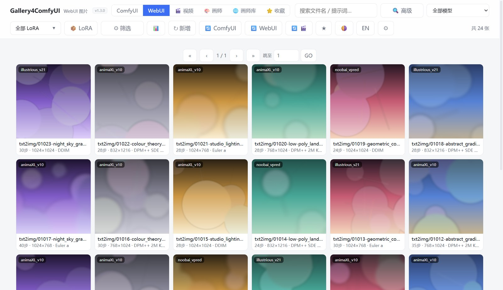
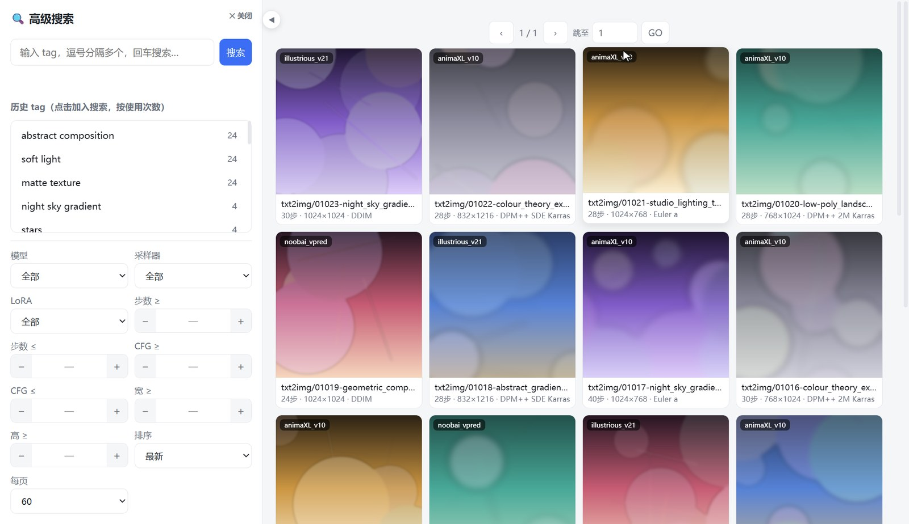
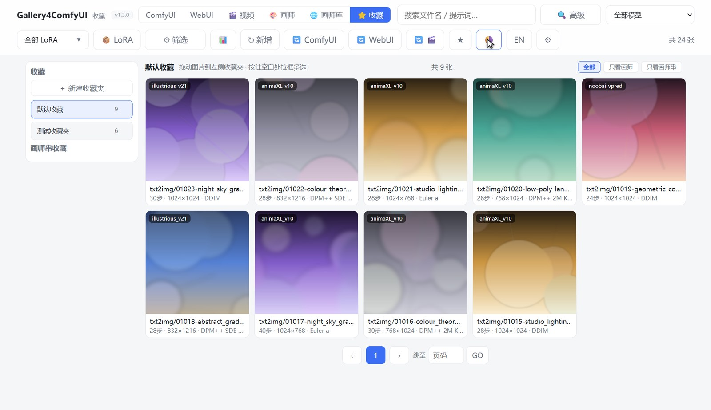
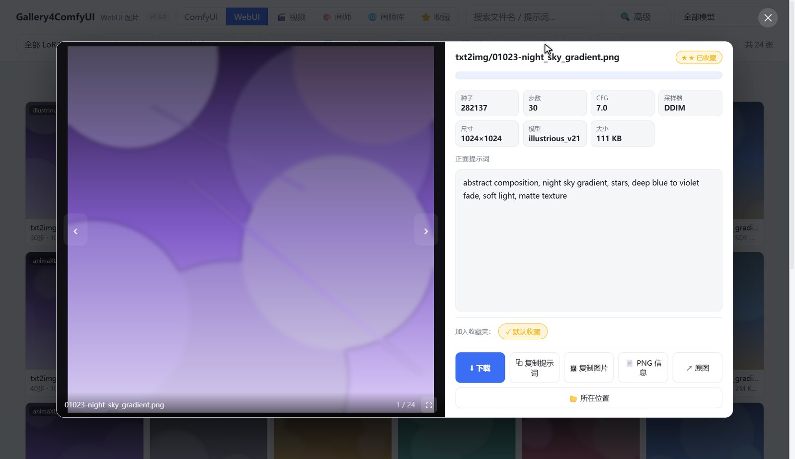
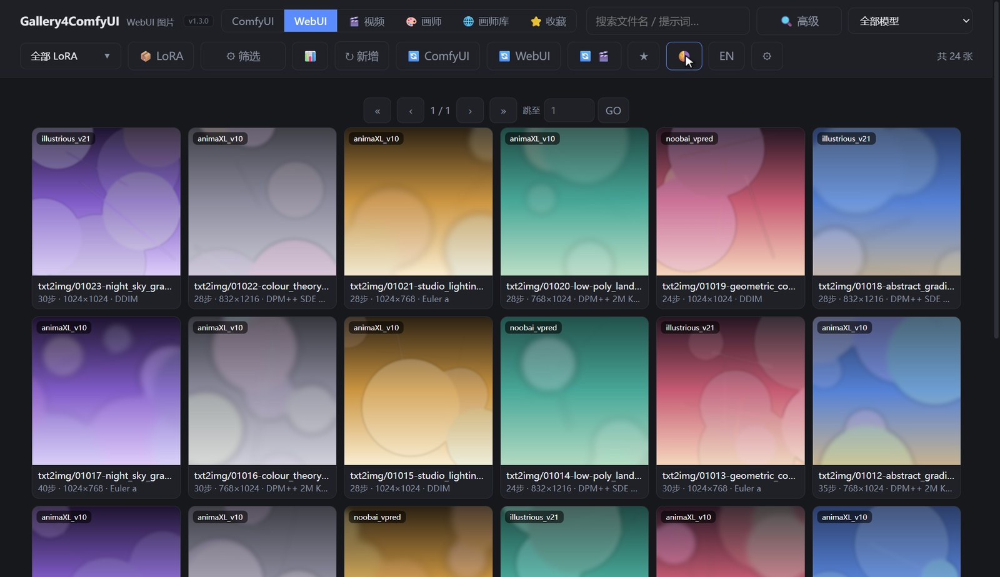

# Gallery4ComfyUI

  
  
  
  
  

**双来源 AI 绘图作品图库** —— 把 ComfyUI 与 Stable Diffusion WebUI 的输出图片集中管理。

浏览、搜索、筛选、收藏、打包，全部在一个界面里完成。

 

 

## 两种形态

| 形态 | 适合场景 | 启动方式 |
|---|---|---|
| **独立桌面版** | 只想看图，不想开 ComfyUI | 双击 `Gallery4ComfyUI.exe` |
| **ComfyUI 插件** | 画完立刻想看 | 节点上点「打开图库」 |

> **懒启动**：插件形态下 ComfyUI 启动时零开销（只注册节点，不扫描、不占资源）。
>
> 点开图库才建索引，后台增量进行，首次之后的打开都是秒开。

 

---

 

## 功能总览

| 模块 | 能力 |
|---|---|
| 数据源 | ComfyUI / WebUI / 视频 / 画师 / 画师库 / 收藏，六个标签页 |
| 搜索 | 文件名 + 正向提示词 + 负向提示词，毫秒级内存过滤 |
| 高级搜索 | tag 统计补全、多 tag 组合（AND）、tag 黑名单、面板可折叠 |
| 筛选 | 画师数 / 采样器 / 步数 / CFG / 尺寸，网格密度与每页数量 |
| 排序 | 最新 / 最旧 / 随机 / 文件名 |
| 收藏 | 多收藏夹、三个视图、拖拽归档、拉框多选批量操作 |
| 灯箱 | 键盘导航、复制提示词/图片、下载、PNG 元数据、定位文件、全屏 |
| 画师 | 本地画师聚合卡片 + 画师权重栏（生成加权画师串） |
| 画师库 | 内置 Danbooru 48,531 位画师，五维筛选 + 关键词搜索 |
| 打包 | 按 LoRA 分组 / 打包选中 / 打包全部结果 |
| 统计 | 各来源的模型分布（按出图数量降序） |
| 外观 | 浅色/深色主题、网格密度三档、中英双语 |
| 幻灯片 | 四种播放模式、11 种转场（**附加功能**，见文末） |

 

---

 

# 功能详解

 

## 数据源

顶部六个标签页，互斥切换：

| 标签 | 内容 |
|---|---|
| **ComfyUI** | ComfyUI `output/` 下的出图 |
| **WebUI** | SD WebUI `outputs/` 下的出图 |
| **视频** | 出图目录里的 mp4 / webm 等，自动关联同名 png 读取元数据 |
| **画师** | 把你自己图库里的画师聚合成卡片 |
| **画师库** | 内置的 Danbooru 画师资料库（48,531 位） |
| **收藏** | 收藏夹 + 收藏的画师 + 收藏的画师串 |

顶栏还有两个下拉：**模型筛选**、**LoRA 筛选**。

 

## 搜索

搜索框支持三个字段同时匹配：

- 文件名
- 正向提示词（positive prompt）
- 负向提示词（negative prompt）

输入即时过滤，不走网络请求，**毫秒级响应**。

 

## 高级搜索

点搜索框旁的「**高级**」进入全屏高级搜索面板。

 

**左侧面板：**

- **tag 统计补全** —— 从你**历史图片**里统计所有出现过的 tag，按使用次数降序排列，每个 tag 后面标明用过多少次
- **多 tag 组合** —— 点选多个 tag 是 **AND** 关系（同时包含才显示）
- **tag 黑名单** —— 把不关心的 tag 屏蔽掉，被屏蔽的不再出现在统计里，也不参与筛选
- **继承普通搜索的全部条件** —— 模型 / 采样器 / 步数 / CFG / 尺寸 / 排序 / 每页数量
- **可折叠** —— 点 ◀ 箭头收起左侧，结果区向左平滑延伸覆盖（带动画）

**右侧：** 结果网格，支持多选后批量操作。

 

## 筛选与排序

点顶栏「**筛选**」展开筛选条，全部条件可组合：

| 条件 | 说明 |
|---|---|
| **画师数 ≥** | 不限 / 2 / 3 / 4 / 5。用来筛「多画师」或「画师串」作品 |
| **采样器** | euler / dpmpp_2m 等 |
| **步数** | 范围（≥ / ≤） |
| **CFG** | 范围（≥ / ≤） |
| **宽 / 高** | 最小尺寸（≥） |
| **排序** | 最新 / 最旧 / 随机 / 文件名 |
| **网格** | 小 / 中 / 大 三档密度 |
| **每页** | 30 / 60 / 120 / 240 |

底部有「**重置**」按钮一键清空所有条件。

 

**分页**：顶部与底部各有一条分页栏，支持首页 / 上一页 / 下一页 / 末页 / 直接输入页码跳转。

 

## 收藏夹

 

**加入收藏**的方式：

1. 灯箱里点星标 → 进「默认收藏」
2. 灯箱下方的收藏夹按钮 → 指定夹
3. 画师页 / 画师库的「收藏画师」与「收藏这个画师串」

 

**收藏页功能：**

| 功能 | 说明 |
|---|---|
| **新建收藏夹** | 建任意多个夹 |
| **三个视图** | `全部` / `只看画师` / `只看画师串` —— 图片、画师、画师串分开看 |
| **拖拽归档** | 把图片直接拖进收藏夹 |
| **拉框多选** | 空白处拖出选框，框选多张后批量拖入 / 移出 |
| **批量操作栏** | 选中后显示「已选 N 张」，可打包选中 / 打包全部结果 / 取消选择 |
| **分页** | 收藏多了也不卡 |

 

## 灯箱

 

点任意图片进入灯箱查看原图。

**按钮：**

| 按钮 | 作用 |
|---|---|
| **下载** | 保存原图 |
| **复制提示词** | 复制正向提示词到剪贴板 |
| **复制图片** | 把图片本身复制到剪贴板（可直接粘贴进聊天框） |
| **PNG 信息** | 查看 PNG 里的原始 metadata（完整 prompt / workflow） |
| **原图** | 在浏览器里打开原图 |
| **所在位置** | 打开文件所在文件夹并选中 |
| **全屏** | 全屏观看 |

 

**键盘：**

- `←` `→` 上一张 / 下一张
- `Esc` 关闭

 

## 画师

「**画师**」标签页把你**自己图库里的画师**聚合成卡片。

 

**卡片内容：**

- **封面** —— 该画师作品的代表图，右下角标注作品数（如 `1/377`）
- **风格描述** —— 从作品里分析出来的风格总结（如「欧美成人漫画 · 平涂描线」）
- **特征 tag** —— 反复出现的题材标签（台词气泡 / 漫画分镜 / 巨乳 / 黑皮 等）
- **`@画师名`** —— 可直接复制的 Danbooru 格式标签
- **统计** —— 收录图数量、本图库内数量、当前权重

 

**排序**：按图片数 / 按最后使用 / 按首次使用 / 按名字 / 随机

**筛选**：搜索画师名、只看收藏画师

 

### 画师权重栏

右侧的「画师权重栏」是画师页的核心工具：

| 操作 | 作用 |
|---|---|
| 点卡片加入 | 把画师加进画师串 |
| **随机权重** | 一键给串里所有画师加随机权重 |
| **清空** | 重置画师串 |
| 提示词框 | 实时生成可用的 `@画师:权重` 串 |
| **复制** | 复制到剪贴板 |
| **收藏这个画师串** | 存进「画师串收藏」，下次直接取用 |

> 顶部圆圈显示当前画师串的总权重，方便控制整体浓度。

 

## 画师库

「**画师库**」是内置的 Danbooru 画师资料库，**48,531 位画师 / 5,239 位已分类**。

 

和「画师」页的区别：

- **画师页** —— 只看**你图库里的**画师
- **画师库** —— **全网公开数据**，可以拿来发现新画师

 

**五维筛选 + 关键词搜索：**

| 筛选 | 示例选项 |
|---|---|
| **类型**（archetype） | 综合向插画师 / R18 情色向 / 同人角色专精 / 原创角色设计师 / 日常治愈系 / 单色线稿派 / 兽耳亚人专精 … |
| **来源**（origin） | 同人为主 / 原创与同人混合 / 原创为主 |
| **向性**（rating） | 全年龄向 / 轻度色气 / 情色向 / 硬核 R18 |
| **主体**（subject） | 群像多人 / 男性主体 / 女性主体 / 非人物静物 / 双人 CP |
| **技法**（technique） | 单色灰度漫画分镜 / 线稿速写 / 特效后期 … |
| **题材/版权** | 关键词搜索 |

每项后面标注数量，方便判断分布。

 

**排序**：作品数 ↓ / 作品数 ↑ / 按名字 / 随机

 

**卡片内容：**

- 封面 + 风格描述（如「速绘平涂 · 舰娘泳装 · 截腿构图」）
- 特征 tag（差分丰富 / 线条干净 / 泳装比基尼 / 大腿特写擦边 …）
- 简介文字
- **作品数 + 尺度标签**（如 `18,794` `全年龄向`）
- **分类标签**（同人角色专精 等）

画师库同样共享右侧的「画师权重栏」，可以边浏览边组画师串。

 

## 打包导出

三种打包方式：

| 按钮 | 范围 |
|---|---|
| **LoRA**（顶栏） | 当前 LoRA 的全部图片，按大模型名分子目录 |
| **打包选中** | 只打包当前选中的图 |
| **打包全部结果** | 当前筛选结果全部打包 |

导出为 zip，内部按大模型分目录，方便归档。

 

## 统计

点顶栏「统计」按钮查看**模型分布** —— 按当前数据源分别统计，每个模型后面标注出图数量，按数量降序排列。

用来快速看出自己主要在用哪个大模型。

 

## 外观与语言

 

| 功能 | 说明 |
|---|---|
| **主题** | 浅色 / 深色一键切换 |
| **网格密度** | 小 / 中 / 大三档，按屏幕大小选 |
| **语言** | 中文 / English 实时切换，无需刷新 |

 

---

 

# 安装

 

## 独立桌面版（推荐）

1. 解压到任意目录（**建议不要放 C 盘根目录**，避免权限问题）
2. 双击 `Gallery4ComfyUI.exe`
3. 首次运行会引导选择 **ComfyUI 输出目录**（不确定就点「浏览」）
4. 开始看图

> 免安装、免 Python、免依赖。
>
> 首次打开会建索引，之后秒开。

 

## ComfyUI 插件

1. 把 `Gallery4ComfyUI` 文件夹放进 `ComfyUI/custom_nodes/`
2. 重启 ComfyUI
3. 在画布中添加节点「**Gallery4ComfyUI**」（分类 Anima）
4. 点击节点上的「**打开图库**」按钮

 

首次打开会引导配置 **SD WebUI 根目录**（含 `outputs` 文件夹的目录）；

跳过则只用 ComfyUI 来源，之后可在页面右上角 ⚙ 随时配置。

> 兼容 ComfyUI 0.3x+。SD WebUI 来源是可选功能，不配置也能用。

 

## 环境要求

| | 要求 |
|---|---|
| 系统 | Windows 10 / 11（64 位） |
| 独立版 | **无需 Python，无需任何依赖** |
| 插件版 | ComfyUI 0.3x+；依赖无（只用 ComfyUI 内置的 aiohttp） |

 

## 数据与存储

所有运行时数据都在软件目录下的 `userdata/`，**不影响任何原有文件**：

| 路径 | 内容 |
|---|---|
| `userdata/index/*.json` | 索引缓存（增量：只重读变化的文件，二次打开秒开） |
| `userdata/thumbs/` | 缩略图缓存 |
| `userdata/settings.json` | 设置（目录配置） |
| `userdata/favorites.json` | 收藏夹 |
| `config.json` | 路径配置（仅独立版，在软件根目录） |

> 删掉 `userdata/` 不会丢图，只会让下次打开重新建索引。

 

## 常见问题

 

**Q：图库打开了但没有图片？**

检查设置里的「ComfyUI 输出目录」是否指向正确的 `output` 文件夹。

 

**Q：图片加载慢？**

首次打开要建索引。索引建好后会缓存到 `userdata/`，之后秒开。

 

**Q：改了图片目录，怎么重新扫描？**

顶栏「🔄 ComfyUI」/「🔄 WebUI」按钮可强制重建索引；

「↻ 新增」只扫增量。

 

**Q：画师库是空的？**

画师库需要 `data/` 目录下的数据文件（随发布版附带）。

如果你是自己 clone 源码，需要把数据文件放到软件根目录的 `data/` 下。

 

---

 

# 附加功能：幻灯片

> 这是**附加功能**，图库本身不需要它。

图库顶栏「其他功能」→「幻灯片」打开独立播放窗口。

 

## 播放模式

| 模式 | 说明 |
|---|---|
| **每秒 N 张** | 固定速率，最高 60 张/秒 |
| **每张 N 秒** | 固定停留时长 |
| **自适应** | 按方向键打节奏，打 3 下后照你的节奏自动播 |
| **跟音乐** | 跟着电脑正在播放的音频切图 |

 

## 跟音乐模式

按电脑**正在播放的音频**的高峰切图 —— 耳机里放什么就抓什么。

 

- 采集的是**系统音频输出**（WASAPI 回环），**不是麦克风**
- **无需任何权限弹窗**
- 阈值两种判定方式：
  - **动态**：阈值跟着音乐自身的响度起伏走。实测音量差 100 倍时，触发结果完全一致
  - **固定**：绝对 dB 门槛，适合想卡一个明确标准的场景
- 灵敏度 1–50 可调
- 实时显示识别到的 BPM
- 自动跳过没有鼓点的前奏

 

**使用**：切到「🎵 音乐」→ 点「开始听」→ 播放音乐即可。

 

## 转场

11 种：

瞬切 / 淡入淡出 / 左右滑 / 上下滑 / 缩放推拉 / 翻卡 3D / 时钟擦除 / 百叶窗 / 像素化 / 节奏型 / 随机

 

## 控制

| 按键 | 作用 |
|---|---|
| `←` `↑` | 上一张 |
| `→` `↓` | 下一张 |
| `空格` | 播放 / 暂停 |
| `Esc` | 退出 |

播放时鼠标静止 2 秒，界面自动隐藏；移动鼠标恢复。

 

---

 

## 更新日志

见 [CHANGELOG.md](CHANGELOG.md)

 

## 许可

MIT License，见 [LICENSE](LICENSE)
